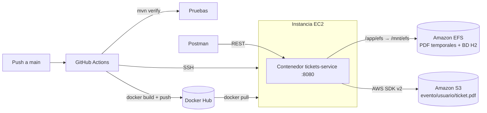

# Sistema de Gestión de Reservas de Eventos con Tickets

**Desarrollo Cloud Native (CDY2204), Experiencia 1, Semana 3: "Construyendo y desplegando una solución Cloud Native"**

Microservicio Spring Boot que genera tickets personalizados en PDF, los guarda temporalmente en **Amazon EFS**, los sube automáticamente a **Amazon S3** organizados por evento y usuario, y se despliega solo en **EC2** mediante **GitHub Actions + Docker Hub** cada vez que se hace push a `main`.

## Arquitectura



**Flujo de un ticket**
1. `POST /api/tickets` guarda el registro y genera el PDF en el EFS: `/app/efs/tickets/evento123/usuarioX/ticket001.pdf`
2. Con `S3_AUTO_UPLOAD=true` (por defecto), el PDF se sube enseguida a S3 con la llave `evento123/usuarioX/ticket001.pdf`
3. Al modificar el ticket se regenera el PDF (sube `fileVersion`) y se reemplaza en S3. Si cambia el usuario o el evento, el archivo se mueve a la nueva carpeta y se borra el antiguo.
4. Al eliminarlo se borra de S3, del EFS y del registro.

El historial (base H2) también vive en el EFS (`/app/efs/db`), así que **no se pierde cuando el pipeline reemplaza el contenedor**.

## Endpoints

| Requisito | Método | Ruta |
|---|---|---|
| Generar tickets | `POST` | `/api/tickets` |
| Subir tickets a S3 | `POST` | `/api/tickets/{id}/upload` |
| | `POST` | `/api/tickets/upload-pending` |
| Descargar por ticket | `GET` | `/api/tickets/{id}/download` |
| Descargar por usuario o evento (ZIP) | `GET` | `/api/tickets/download?eventId=&userId=` |
| Modificar detalles del ticket | `PUT` | `/api/tickets/{id}` |
| Eliminar tickets específicos | `DELETE` | `/api/tickets/{id}` |
| Estadísticas de ventas y reservas por evento | `GET` | `/api/stats/events` · `/api/stats/events/{eventId}` |
| Historial de tickets generados | `GET` | `/api/tickets?eventId=&userId=&status=&from=&to=` |
| Ver archivos en EFS (demo) | `GET` | `/api/storage/efs` |
| Ver objetos en S3 (demo) | `GET` | `/api/storage/s3?prefix=evento123/` |
| Salud | `GET` | `/actuator/health` |

Estados del ticket: `RESERVADO` (reserva), `PAGADO` (venta), `CANCELADO`.

**Ejemplo: generar ticket**
```json
POST /api/tickets
{
  "eventId": "evento123",
  "eventName": "Concierto Rock 2026",
  "eventDate": "2026-12-15",
  "venue": "Movistar Arena",
  "userId": "usuarioX",
  "userName": "Juan Perez",
  "userEmail": "juan.perez@mail.com",
  "seat": "A-10",
  "price": 35000,
  "status": "PAGADO"
}
```

**Ejemplo: estadísticas**
```json
GET /api/stats/events/evento123
{
  "eventId": "evento123", "eventName": "Concierto Rock 2026",
  "totalTickets": 2, "reservados": 1, "vendidos": 1, "cancelados": 0,
  "ingresosVentas": 35000.00, "montoReservado": 35000.00,
  "usuariosUnicos": 2, "subidosAS3": 2
}
```

La colección completa está en [`postman/Tickets-Service.postman_collection.json`](postman/Tickets-Service.postman_collection.json). Impórtala y cambia la variable `baseUrl` por `http://<IP-PUBLICA-EC2>:8080`.

## Variables de entorno

| Variable | Descripción | Por defecto |
|---|---|---|
| `S3_BUCKET` | Nombre del bucket | *(obligatoria)* |
| `AWS_REGION` | Región | `us-east-1` |
| `S3_AUTO_UPLOAD` | Subir automáticamente al generar/modificar | `true` |
| `EFS_PATH` | Ruta del EFS dentro del contenedor | `/app/efs` |
| `AWS_ACCESS_KEY_ID` / `AWS_SECRET_ACCESS_KEY` / `AWS_SESSION_TOKEN` | Credenciales (no hacen falta si la EC2 tiene el rol `LabInstanceProfile`) | |

## Ejecutar localmente

```bash
# Requiere Java 17 y Maven
mvn verify                       # compila y corre las pruebas (S3 simulado)
docker build -t tickets-service .
docker run -p 8080:8080 -v $(pwd)/efs-local:/app/efs \
  -e S3_BUCKET=mi-bucket -e AWS_ACCESS_KEY_ID=... -e AWS_SECRET_ACCESS_KEY=... -e AWS_SESSION_TOKEN=... \
  tickets-service
```

## Despliegue

- Configuración paso a paso de AWS (S3, EFS, EC2) y de los secrets de GitHub: [`docs/GUIA_DESPLIEGUE_AWS.md`](docs/GUIA_DESPLIEGUE_AWS.md)
- Guion para el video de presentación, alineado con la pauta: [`docs/GUION_VIDEO.md`](docs/GUION_VIDEO.md)

## Estructura

```
├── .github/workflows/main.yml   # Pipeline CI/CD
├── Dockerfile                   # Build multi-etapa
├── postman/                     # Colección de pruebas
├── docs/                        # Guía de despliegue y guion del video
└── src/main/java/cl/duoc/tickets
    ├── config/      # Propiedades y cliente S3
    ├── model/       # Entidad Ticket
    ├── repository/  # Spring Data JPA
    ├── dto/         # Requests / responses
    ├── service/     # EFS, S3, PDF, tickets, estadísticas
    └── web/         # Controladores REST y manejo de errores
```
